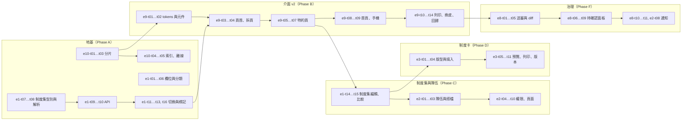

# PRD — 產品需求文件

淡江橋館的產品需求都在這個資料夾，結構與姊妹站淡江牌桌相同：

```
00-prd.md（總 PRD：願景、範圍、F 功能需求、AC 總表、里程碑）
   └─ e1 … e10（每個 epic 一份：背景、目標、AC、task 拆分）
         └─ AC-<epic>.<n>（驗收條件，可勾選）
               └─ e<epic>-t<nn>（task：一個 task ≈ 一個 PR 的一部分 ≈ 0.5–3 天）
```

| 文件 | 內容 |
| --- | --- |
| [`00-prd.md`](00-prd.md) | 總 PRD：願景、問題、使用者、原則、功能地圖、F1–F46、非功能、AC 總表、M0–M3、指標、風險 |
| `e1` … `e11` | 各 epic，見下表 |
| [`../ROADMAP.md`](../ROADMAP.md) | 批次順序（一批 = 一個 PR = 一個 AI session） |
| [`../NEXT.md`](../NEXT.md) | 現在的位置與工作方式 |
| [`../HEALTH-CHECK.md`](../HEALTH-CHECK.md) | 2026-10-24 專案健檢與建議 |
| [`../DESIGN-V2.md`](../DESIGN-V2.md)、[`../design/mockup-v2.html`](../design/mockup-v2.html)、[`../design/pitch.html`](../design/pitch.html) | 介面 v2 規格、中國風視覺稿、六種風格×四種版面與個人設定的展示頁 |

## Epic 進度

統計日期 2026-10-28。勾選以各 epic 文件為準，改了勾選順手更新這張表。

| Epic | 名稱 | Task 完成 | AC 完成 | 里程碑 | 狀態 |
| --- | --- | --- | --- | --- | --- |
| [E1](e1-content-model-system-profiles.md) | 內容模型與制度集 | 16／16 | 7／7 | M1 | done |
| [E2](e2-teams-partnerships.md) | 隊伍與搭檔 | 9／10 | 5／7 | M1 | in progress |
| [E3](e3-convention-card-generator.md) | 制度卡產生器 | 7／13 | 2／8 | M1（t13 M2） | in progress |
| [E4](e4-levels-learning-path.md) | 分級與學習路徑 | 0／12 | 0／6 | M2 | planned |
| [E5](e5-library-articles-ebooks.md) | 橋藝叢書 | 0／15 | 0／8 | M2 | planned |
| [E6](e6-quiz-practice.md) | 練習與測驗 | 4／9 | 2／6 | M2 | in progress |
| [E7](e7-bridgetable-integration.md) | 與淡江牌桌整合 | 5／8 | 2／5 | M2 | in progress |
| [E8](e8-content-governance.md) | 內容治理 | 3／14 | 1／6 | M1、M2 | in progress |
| [E9](e9-ui-redesign.md) | 介面重新設計（v2） | 18／18 | 6／10 | M1 | in progress |
| [E10](e10-platform-performance-ops.md) | 平台、效能與維運 | 7／11 | 2／6 | M1、M2、M3 | in progress |
| [E11](e11-community-forum.md) | 社群與討論 | 8／21 | 1／9 | M1（t21 M2） | in progress |
| | **合計** | **77／147** | **28／78** | | |

里程碑分布：M1 約 90 個 task、M2 約 54 個、M3 2 個（概數，以 ROADMAP 為準）。M0 的功能（F1–F18）在 2026-10-21～23 完成，沒有拆成 task。

## Task 格式

```markdown
- [ ] `e1-t08` `lib/profiles.ts`：`resolveProfile` 與 `origin` 標記 … · AC-1.4 · M · ← e1-t07
- [x] `e1-t01` `Convention` 加 `kind`、`level` … · AC-1.1 · #7
```

| 欄位 | 說明 |
| --- | --- |
| 編號 | `e<epic>-t<nn>`，epic 內的流水號。**不重用、不改號**；作廢的 task 加刪除線並寫原因 |
| 做什麼 | 一句話，看得出 PR 的範圍與驗收方式 |
| 對應 AC | 這個 task 交付哪一條（或哪幾條）AC |
| 大小 | 未完成的 task：`S`（≤ 1 天）或 `M`（1–3 天）。**沒有 L**，超過 3 天就拆 |
| 依賴 | `← e1-t07`：要先合併的 task。只寫真正會卡住的依賴；寫到別的 epic 的 task 也可以 |
| PR | 已完成的 task：合併的 PR 號（`#7`） |

規則：

1. **一批相關的 task 一個 PR**（ROADMAP 的一「批」）。分支名帶第一個 task 編號（例如 `feat/e1-t07-system-profile-types`），PR 標題結尾列出全部編號（例如 `feat(profiles): system profile types and resolver [e1-t07, e1-t08]`），PR 本文寫對應的 AC 與驗證方式。
2. **在同一個 PR 勾選**：把自己的 task 從 `[ ]` 改成 `[x]`，大小與依賴換成 PR 號，並更新上面的進度表、ROADMAP 的批次、`NEXT.md` 的「現在的位置」。
3. **AC 什麼時候勾**：這條 AC 的 task 全部完成，而且有人照 AC 文字實際驗證過（測試或實測寫在 PR）。
4. **發現新工作就加 task**：接在該 epic 最後一個編號之後，放到正確的里程碑區段，不要塞進正在做的 PR。
5. **牽涉淡江牌桌的 task**（E2 的隊伍、E7、E8 通知、E10 備份）：PR 本文寫牌桌端對應的 PR 號；型別以牌桌 `shared/protocol.ts` 為準。

## M1 建議順序

M1 的五件事（制度集、首頁與個人設定、隊伍與搭檔、制度卡、討論區）共用兩個地基：內容分片（E10）與制度集模型（E1）。討論區（E11）在 E9 之後可與 E2／E3 平行。順序：



| 波次 | 內容 | 可以平行 |
| --- | --- | --- |
| 第 1 波 | 地基：`e10-t01`～`t05`、`e1-t01`～`t10` | 分片線與制度集線互不依賴 |
| 第 2 波 | 介面 v2（E9）全部；期間只合併內容與 bug 修 | 不平行（避免兩套樣式） |
| 第 3 波 | 制度集編輯 → 隊伍與搭檔（E2）→ 制度卡（E3）；治理（E8）與討論區（E11）可與 E2／E3 平行 | 三條線 |

M2 從分級（E4）開始，因為新生社課最急；叢書（E5）與練習（E6）互不依賴可平行；牌桌整合（E7）看牌桌 E5 的進度。

## 怎麼新增一個 epic

1. 檔名 `e<n>-<英文-slug>.md`，frontmatter 照現有 epic（`title`、`date`、`status`、`epic`、`owner`、`milestones`、`depends_on`）。
2. 章節：背景、目標、非目標、需求（功能／非功能）、設計方向、驗收條件、Task 拆分、風險與對策、未決問題。
3. 在 `00-prd.md` 的功能地圖（§6）、功能需求（§8.2）與 AC 總表（§10）加上它，並更新本頁的進度表與 `ROADMAP.md`。
